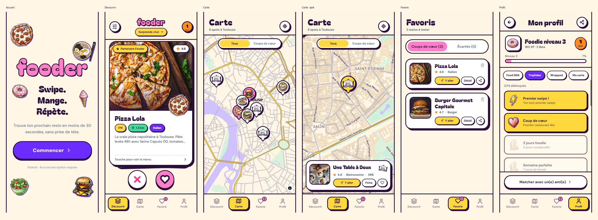

# Fooder

Application web mobile-first de découverte de restaurants, façon Tinder : on swipe à droite pour garder un resto, à gauche pour passer. Direction artistique **Bubbly Maximalism** : contours épais, ombres dures, stickers illustrés, typographie ronde.



## Fonctionnalités

- **Swipe** : deck de cartes avec physique au doigt, tampons MIAM / BOF pendant le glissement, explosion de stickers au like.
- **Humeur** : choisir son envie du moment filtre le deck, modifiable à tout moment.
- **Fiche restaurant** : photos, menu, adresse, bouton « Y aller » (Google Maps).
- **Carte** : fond de carte aux couleurs de l'app (MapLibre + OpenFreeMap), pins-stickers, mini-fiche, filtre sur les coups de cœur.
- **Favoris** : liste des coups de cœur et des restos écartés.
- **Profil** : Food DNA (archétype calculé depuis les likes), trophées, Wrapped, exploration des quartiers.
- **Gamification** : XP, niveaux, streak quotidien, missions et trophées calculés en arrière-plan.
- **Freemium** : 20 swipes gratuits par jour, Premium activable en un clic pour le test (aucun vrai paiement).
- **PWA** : installable sur l'écran d'accueil.

## Stack

Next.js 14 (App Router) · React 18 · TypeScript · Tailwind CSS · Framer Motion · MapLibre GL.
Les données sont stockées dans le `localStorage` du navigateur : pas de backend à ce stade.

## Lancer en local

```bash
npm install
npm run dev
```

L'application tourne sur <http://localhost:3000>.

Par défaut, elle utilise 8 restaurants de démonstration à Toulouse. Pour charger de vrais restaurants autour de l'utilisateur, copier `.env.example` en `.env.local` et renseigner une clé Google Maps (API Places activée, facturation activée côté Google). **Restreindre la clé à votre domaine** dans la console Google.

## Structure

```
app/            pages (onboarding, swipe, carte, favoris, profil) et layout
components/     composants d'interface, swipe, carte, navigation
hooks/          XP, streak, missions, Food DNA, freemium
lib/            règles de stickers, style de carte, accès Google Places
data/           restaurants de démonstration
public/stickers 31 stickers (WebP) de la direction artistique
```

## Direction artistique et assets

Les 31 stickers (plats, badges de trophées) ont été générés en local avec Stable Diffusion XL guidé par une image de référence, puis détourés et habillés par script (contour et ombre identiques pour tous). Le développement a été assisté par IA (Claude Code) ; les choix de direction artistique et de produit sont les miens.

## Crédits

- Polices : [Bagel Fat One](https://fonts.google.com/specimen/Bagel+Fat+One) et [DM Sans](https://fonts.google.com/specimen/DM+Sans) (SIL OFL)
- Fond de carte : [OpenFreeMap](https://openfreemap.org), © [OpenMapTiles](https://www.openmaptiles.org/), données © [contributeurs OpenStreetMap](https://www.openstreetmap.org/copyright)
- Photos de démonstration : [Unsplash](https://unsplash.com)
- Icônes d'interface : [Lucide](https://lucide.dev)

Tous droits réservés sur le code et les assets, sauf mention contraire.
